<!--
  Generated automatically; edits to this file are overwritten.
  The numbers, charts and snake refresh every 6 hours.
-->

<a href="https://musman-portfolio.vercel.app"><picture><source media="(prefers-color-scheme: dark)" srcset="assets/hero-dark.svg"><source media="(prefers-color-scheme: light)" srcset="assets/hero-light.svg"></picture></a>

<a href="https://musman-portfolio.vercel.app"><picture><source media="(prefers-color-scheme: dark)" srcset="assets/buttons/portfolio-dark.svg"><source media="(prefers-color-scheme: light)" srcset="assets/buttons/portfolio-light.svg"></picture></a>
<a href="https://musman-portfolio.vercel.app/Usman-Resume.pdf"><picture><source media="(prefers-color-scheme: dark)" srcset="assets/buttons/resume-dark.svg"><source media="(prefers-color-scheme: light)" srcset="assets/buttons/resume-light.svg"></picture></a>
<a href="https://www.linkedin.com/in/musman21/"><picture><source media="(prefers-color-scheme: dark)" srcset="assets/buttons/linkedin-dark.svg"><source media="(prefers-color-scheme: light)" srcset="assets/buttons/linkedin-light.svg"></picture></a>
<a href="https://musman-portfolio.vercel.app/#contact"><picture><source media="(prefers-color-scheme: dark)" srcset="assets/buttons/email-dark.svg"><source media="(prefers-color-scheme: light)" srcset="assets/buttons/email-light.svg"></picture></a>

<picture><source media="(prefers-color-scheme: dark)" srcset="assets/about-dark.svg"><source media="(prefers-color-scheme: light)" srcset="assets/about-light.svg"></picture>

<a href="https://github.com/Muhammad-Usman21"><picture><source media="(prefers-color-scheme: dark)" srcset="assets/numbers-dark.svg"><source media="(prefers-color-scheme: light)" srcset="assets/numbers-light.svg"></picture></a>

<picture><source media="(prefers-color-scheme: dark)" srcset="assets/chart-months-dark.svg"><source media="(prefers-color-scheme: light)" srcset="assets/chart-months-light.svg"></picture> 
<picture><source media="(prefers-color-scheme: dark)" srcset="assets/chart-weekdays-dark.svg"><source media="(prefers-color-scheme: light)" srcset="assets/chart-weekdays-light.svg"></picture>
<picture><source media="(prefers-color-scheme: dark)" srcset="assets/chart-languages-dark.svg"><source media="(prefers-color-scheme: light)" srcset="assets/chart-languages-light.svg"></picture>

<a href="https://github.com/Muhammad-Usman21"><picture><source media="(prefers-color-scheme: dark)" srcset="assets/activity-dark.svg"><source media="(prefers-color-scheme: light)" srcset="assets/activity-light.svg"></picture></a>

<a href="mailto:musman.akhtar21@gmail.com"><picture><source media="(prefers-color-scheme: dark)" srcset="assets/contact-dark.svg"><source media="(prefers-color-scheme: light)" srcset="assets/contact-light.svg"></picture></a>

